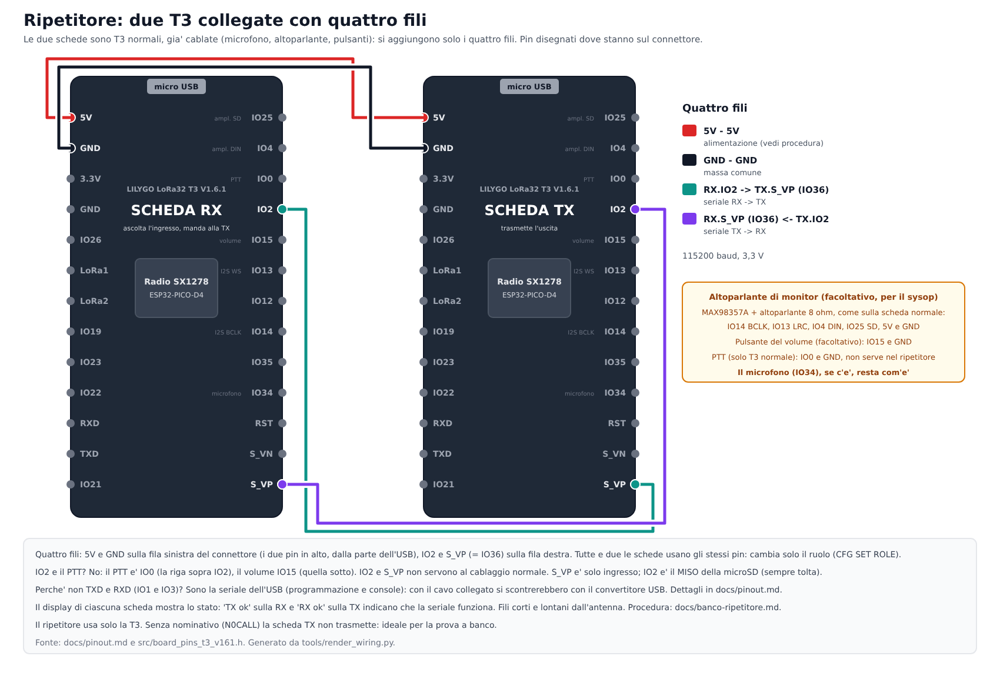

# Il ripetitore: riepilogo (12/11/2026)

Pagina di riepilogo di tutto quello che il ripetitore fa e di come si collega. I dettagli e le decisioni sono nei documenti collegati. **Stato: tutta la logica è provata sul PC e il firmware compila (GitHub Actions); nulla è ancora stato provato sulle schede.** La prima prova è a banco: [banco-ripetitore.md](banco-ripetitore.md).

## Come è fatto
*Il collegamento a Internet (nodo su Wi-Fi) invece funziona anche su T-Beam: [studio-nodo-internet.md](studio-nodo-internet.md).*

- **Due T3 V1.6.1 normali, già cablate come stazioni** (microfono, altoparlante, pulsanti restano come sono). Due T-Beam sarebbero uno spreco: il ripetitore è solo T3 e il firmware rifiuta il ruolo sulla T-Beam.
- **Scheda RX:** ascolta la frequenza di **ingresso** (quella del profilo), decide cosa ripetere e lo manda alla TX. Non trasmette mai.
- **Scheda TX:** ritrasmette sulla frequenza di **uscita** (`FREQOUT`), ascolta i messaggi quando è libera, manda identificativo, annunci e risposte del sysop.
- **Un solo profilo ripetuto** per ripetitore (di base Standard, Codec2 3200, SF7/250 kHz), più il Messaggio sulla frequenza di uscita per i messaggi.
  Il profilo di base è lo Standard (3200) dal 12/11/2026; il Range (1200, un po' più di portata) si può ancora scegliere per un ripetitore che serve stazioni al limite ([decisione](roadmap.md)).

## Collegamento: quattro fili
5V, GND e la seriale incrociata (115200 baud, 3,3 V): **RX.IO2 → TX.S_VP (IO36)** e **TX.IO2 → RX.S_VP**. Sono pin che il cablaggio normale non usa, quindi l'altoparlante di monitor e il pulsante del volume si collegano alla RX come su una scheda normale. microSD sempre tolta. Alimentazione e pin sono **da verificare sul banco**. Schema:  ([firmware.md](firmware.md), [pinout.md](pinout.md)).

## Come si configura
Dalla **pagina di configurazione** (quella interna della scheda o il sito con il cavo USB), sezione *Ripetitore*, oppure da seriale. Valgono dal riavvio.

| Cosa | Comando | Note |
|---|---|---|
| Ruolo | `CFG SET ROLE OFF\|RPTRX\|RPTTX` | una scheda in ruolo da ripetitore non ha il menu a bordo: per tornare stazione serve il cavo USB |
| Frequenza di ingresso | `CFG SET FREQ` | quella del profilo, sulla RX |
| Frequenza di uscita | `CFG SET FREQOUT` | sulla TX; è anche la frequenza dei messaggi |

*Nel sito delle impostazioni (16/11/2026):* la scheda **TX** mostra **una sola frequenza**, quella di uscita, perché la radio lavora solo su quella (`outFreqKhz` al posto della frequenza del profilo, anche per i messaggi); la scheda **RX** mostra "Frequenza di ingresso" (quella su cui ascolta le stazioni), senza l'uscita.
| Shift delle **stazioni** che usano il ripetitore | `CFG SET SHIFT <kHz da -10000 a +10000>` (0 = nessuno) | sulle stazioni, non sulle schede del ripetitore: ascoltano su `FREQ` (uscita) e trasmettono su `FREQ` + shift (ingresso; lo shift è libero da 0 a 10 MHz, in positivo o negativo); di base 0; la frequenza spostata deve restare in 430-440 MHz ([firmware.md](firmware.md)) |
| Nominativo | `CFG SET CALLSIGN` | con N0CALL la TX non trasmette (ideale a banco) |
| Altoparlante di monitor | `CFG SET MONITOR ON` | solo RX |
| Identificativo ogni N minuti | `CFG SET IDINT 1..10` | di base 10 |
| Identificativo in Morse FM | `CFG SET IDMORSE ON\|OFF` | di base acceso |
| Sysop | `CFG SET SYSOP`, `SYSOPKEY`, `SYSOPMODE` | vedi sotto |

## Cosa fa
| Funzione | Come | Dettagli |
|---|---|---|
| **Voce** | la RX ripete i pacchetti del modo del profilo (e il testo) con il flag `RELAYED`, senza ripetere due volte lo stesso pacchetto né un pacchetto già ripetuto; sessione massima 35 s; la TX li trasmette con 80 ms fra uno e l'altro | [studio-ripetitore.md](studio-ripetitore.md) |
| **Testo** (modo 7) | ripetuto come un pacchetto qualsiasi, fuori dalla durata del turno vocale | [protocollo.md](protocollo.md) |
| **Messaggi vocali** (profilo Messaggio, SF12/125 kHz) | la TX li riceve quando è libera, ricostruisce i pacchetti persi con la parità, li tiene (massimo 15 s di voce, 3 messaggi, 30 minuti) e li ritrasmette dopo 20 s di silenzio vocale con una sessione nuova. La voce ha sempre la precedenza: interrompe il messaggio, che riparte da capo | [studio-ripetitore.md](studio-ripetitore.md), [modo-messaggio.md](modo-messaggio.md) |
| **Annuncio di occupato** (modo 6) | prima di ritrasmettere un messaggio la TX manda, con i parametri della voce, il tempo previsto; le stazioni lo mostrano ("RIP. OCCUPATO") e **non bloccano il PTT**. A fine servizio un annuncio a zero | [protocollo.md](protocollo.md) |
| **Identificativo** | ogni 1-10 minuti un testo con il nominativo del ripetitore (seq 1): le stazioni lo mostrano come "Ultimo N0CALL ID" con il segnale, **senza bip** e senza casella. Una voce passata dal ripetitore si legge "Ultimo N0CALL via RPT" | [protocollo.md](protocollo.md), [display.md](display.md) |
| **Morse in FM** | dopo il testo, il nominativo in Morse con un tono in FM stretta (15 wpm, 700 Hz, ±2,5 kHz): per chi non ha le schede LoRa. La voce lo interrompe | [studio-identificativo-fm.md](studio-identificativo-fm.md) |
| **Comandi del sysop** (modo 5) | STATO, SPEGNI (anche a tempo), RIACCENDI, RIAVVIA, IDENTIFICA, POTENZA (salvata in memoria); firmati con HMAC-SHA256 e contatore anti-ripetizione; la TX risponde firmata. Sulla scheda del sysop il **modo Sysop** mette nel menu "Comandi Sysop" al posto di "Invia testo" | [protocollo.md](protocollo.md), [studio-ripetitore.md](studio-ripetitore.md) |
| **Sicurezza** | una trasmissione continua oltre 60 s di voce (180 s di messaggio) spegne la TX per 5 minuti | [studio-ripetitore.md](studio-ripetitore.md) |
| **Monitor audio** | la RX fa ascoltare la voce che riceve all'altoparlante (per il sysop in postazione); i display di RX e TX mostrano lo stato del collegamento e i contatori | [firmware.md](firmware.md) |

## In rete, con il reflector (13/11/2026, provato sul PC)
La scheda **RX** si può collegare a un reflector ([reflector.md](reflector.md)) con le stesse impostazioni del nodo (`WIFISSID`, `WIFIPASS`, `PEER` anche come nome, `PEERID`, `NODEID`, `NODEKEY`): quello che la RX ripete va anche al reflector e i pacchetti del reflector passano per la seriale alla TX, che li trasmette sull'uscita. **Nessuna porta aperta sul router.** Chi parla per primo (radio o rete) tiene l'uscita; il testo passa sempre. Senza queste impostazioni il ripetitore resta solo in radio.

**Come un messaggio passa dal ripetitore (18/11/2026).** Nel profilo Messaggio **non c'è un indirizzo né un "salto" scelto dal mittente**: il solo segno del salto è il flag `RELAYED` che la TX aggiunge quando ritrasmette (sessione nuova). Il mittente trasmette sulla **frequenza di uscita** (lo shift non vale nel Messaggio): la TX del ripetitore è lì in ascolto, tiene il messaggio e lo ritrasmette dopo 20 s di silenzio vocale. Chi è nel raggio del mittente lo riceve **subito direttamente** e poi **una seconda volta** dal ripetitore (le due copie non si riconoscono come lo stesso messaggio); chi è fuori portata riceve solo la copia del ripetitore. Per provare il passaggio serve quindi un ricevitore che **non senta il mittente** (distanza, potenza minima, ostacoli). **Chi riceve vede da dove è arrivato (18/11/2026):** il messaggio in casella dice "MESSAGGIO via RPT" se è passato da un ripetitore (flag `RELAYED`) oppure "MESSAGGIO DIRETTO"; lo stesso nella riga "Riproduco (via RPT)/(diretto)" e nel titolo del testo ("da N0CALL via RPT"). **Il nodo Internet non tiene né ritrasmette i messaggi**: ha una sola radio e non può ascoltare insieme la voce Standard (SF7/250 kHz) e il Messaggio (SF12/125 kHz). **La RX non vede i messaggi** (ascolta sull'ingresso): il registro utile è quello della **TX**, riga `[ripetitore] TX messaggi: ...` (pacchetti ascoltati, messaggi completi, in archivio, ritrasmessi, interrotti), stampata a ogni cambiamento; sul display della TX l'ultima riga mostra `M<in archivio>/<ritrasmessi>`.

## Cosa non è provato, cosa manca
- **Tutto è provato solo sul PC** (suite di test, pagine web) e compilato dalla CI. Mai in aria, mai su due schede collegate.
- **Da verificare sul banco:** i pin della seriale (IO2 e S_VP/IO36) e l'alimentazione a quattro fili; il cambio dei parametri radio fra voce e messaggi; il passaggio LoRa → FSK → LoRa del Morse; i valori del Morse (tono, deviazione, velocità, salita) con il firmware di prova `CFG RADIOTEST`.
- **Limiti noti:** le stazioni LoRa non vedono il Morse in FM (il controllo del canale non rileva FSK); la risposta del sysop si sente solo con il profilo del ripetitore; il ripetitore non risponde ai comandi con firma sbagliata (voluto); un solo profilo ripetuto.
- Le questioni legali e di autorizzazione del ripetitore sono dell'operatore e non sono trattate qui.

## Dove leggere
[banco-ripetitore.md](banco-ripetitore.md) (prova a banco) · [studio-ripetitore.md](studio-ripetitore.md) (studio e decisioni) · [studio-identificativo-fm.md](studio-identificativo-fm.md) (Morse in FM) · [firmware.md](firmware.md) (comandi e collegamenti) · [protocollo.md](protocollo.md) (modi 5, 6, 7) · [pinout.md](pinout.md) (pin e schemi).

## Diagnosi del collegamento seriale RX-TX (16/11/2026)

Se il display della RX dice **"TX NON RISPONDE"** (o quello della TX "RX NO"), le due schede stampano sulla **seriale USB** una riga di diagnosi (subito a ogni cambio, poi ogni 5 s finché il collegamento manca, ogni 30 s quando c'è):

```
[ripetitore] RX: seriale con la TX SILENZIOSA (ricezione IO36, trasmissione IO2, 115200): byte ricevuti 0, frame validi 0 (battiti/stati 0), CRC errati 0, frame mandati 12 -> nessun byte: controlla i fili ...
```

- **byte ricevuti 0**: non arriva niente: fili (la RX della scheda va all'IO2 dell'altra e viceversa, **incrociati**: IO36 di una con IO2 dell'altra), **massa in comune**, l'altra scheda accesa e nel suo ruolo (TX o RX), cavo non troppo lungo. "Frame mandati" che cresce dice che questa scheda sta trasmettendo.
- **byte ricevuti > 0 ma frame validi 0**: i byte arrivano ma non sono frame (disturbi, fili lunghi, velocità diversa).
- **frame validi > 0 ma "SILENZIOSA"**: il collegamento c'era e si è fermato (l'altra scheda riavviata o spenta).
- **ATTIVA**: tutto bene; "battiti/stati" è il numero di battiti (sulla TX) o di stati (sulla RX) ricevuti.

Mandare le due righe (RX e TX) permette di capire da che parte è il guasto.

**Lo shift non riguarda il ripetitore (16/11/2026).** Lo shift è della stazione normale: ripetitore (RX e TX) e nodo lo ignorano. Il firmware non lo controlla più contro la banda quando il ruolo non è stazione normale, e le pagine di configurazione **non mandano comandi SHIFT** né lo mostrano in quei ruoli, e mandano il ruolo **prima** delle frequenze. Prima, una RX a 440.000 MHz con uno shift rimasto dalla stazione normale rifiutava il salvataggio (`CFG ERR shift la frequenza di trasmissione uscirebbe da 430-440 MHz`). Tornando stazione normale lo shift conta di nuovo: se non sta in banda con le frequenze, `CFG SET ROLE OFF` si rifiuta e chiede `CFG SET SHIFT 0`.

## La RX configura la TX sul filo seriale (16/11/2026)

**Perché.** Prima la TX si configurava a parte, con il proprio cavo USB (ruolo "scheda TX" e parametri). Ora la TX **non si configura più a parte**: si dà tutto sulla RX (sito o pagina della scheda) e la RX lo manda alla TX. (Il blocco delle schede visto il 16/11/2026 durante gli aggiornamenti **non dipendeva dalla seriale né dall'alimentazione**: era un filo collegato a un pin sbagliato. Chiuso.)

**Cosa viaggia:** frequenza di uscita (obbligatoria sulla RX per partire), potenza (della TX), profilo, identificativo ogni N minuti e Morse, nominativo, chiave del sysop. Il resto (ruolo, frequenze del profilo, Wi-Fi, impostazioni della stazione) resta com'è sulla TX. **La scheda TX non si imposta**: vedi la sezione "La TX si forza da sola" qui sotto (dal 16/11/2026).

**Come funziona** (`repeater_config.h`, provato sul PC in `test_repeater_config`):
1. Ogni secondo la TX manda alla RX il suo **stato**; dal 16/11/2026 lo stato porta anche la **firma** (FNV-1a a 32 bit) della configurazione che la TX ha adesso.
2. La RX confronta quella firma con la propria. Se è diversa (e lo stato è recente) manda un frame **configurazione** (tipo 6, 34 byte: versione, profilo, potenza, identificativo, Morse, uscita, nominativo, chiave).
3. La TX **controlla** (versione, intervalli, nominativo, banda 430-440), **salva** nella memoria come se fosse un `CFG SET`, risponde con un frame di conferma (tipo 7: 0 applicata, 1 non valida, 2 non salvata, 3 già uguale) e si **riavvia da sola** dopo 1,5 s.
4. Dopo il riavvio la TX riparte con la firma giusta: la RX stampa "la TX ha la configurazione giusta" e smette.

**Sicurezza.** Se la TX non accetta (non valida o non salvata), la RX riprova ogni 4 s per **5 volte** e poi si ferma e lo scrive ogni 30 s: una TX che non applica la configurazione non si riavvia all'infinito. Cambiando la configurazione sulla RX il conteggio riparte. Con la **TX con firmware vecchio** (che non manda la firma) la RX non manda niente. Se sulla RX l'uscita è 0 (non impostata) la RX **non tocca** la TX.

**Potenza e comandi del sysop.** Un comando `POTENZA` del sysop passa dalla RX, che lo verifica e lo gira alla TX: la RX aggiorna **anche la sua** potenza salvata, così non è lei a riportare la TX al valore di prima.

**Sui display.** La RX mostra "TX config in invio" finché la TX non ha la configurazione giusta, "TX config RIFIUTATA" se si è fermata dopo i tentativi.

**Sulla seriale USB** (RX): `configurazione mandata alla TX (tentativo n di 5): uscita ... potenza ... identificativo ...`, `la TX risponde alla configurazione: ...`, `la TX ha la configurazione giusta`. (TX): `configurazione dalla RX applicata e salvata (riavvio fra poco)` / `gia' uguale` / `NON VALIDA`.

**Da provare sulla scheda vera:** il riavvio della TX dopo la configurazione e il ritorno al collegamento; la RX che non riprova all'infinito; la potenza cambiata dal sysop che non viene sovrascritta. Aggiornare **prima la TX**, poi la RX (una TX con il firmware di prima ignora il frame e non cambia).

## La TX si forza da sola, senza ruolo e senza quinto filo (16/11/2026)

**Procedura:** carica **lo stesso firmware** sulle due schede (una alla volta, staccate dai fili), imposta il ruolo **"scheda RX"** (e tutti i parametri) **solo sulla RX**, collega i **quattro fili** (5 V, massa, seriale TX e RX incrociate: IO2 di una con IO36 dell'altra) e accendi. La scheda che non è la RX resta in ruolo normale (o nodo): ascolta passivamente IO36, riconosce i **battiti** della RX (un frame al secondo con il CRC giusto) e dopo circa 3 secondi **si riavvia come TX del ripetitore**. La RX le manda poi la configurazione (sezione precedente).

- **Il ruolo salvato non cambia.** Se scolleghi la RX la scheda torna com'era al riavvio. `CFG GET` mostra ancora `role=off` (o `node`): la scheda è TX solo mentre i battiti arrivano. Sul display compare "RIPETITORE TX forz." e la seriale scrive `TX forzata dalla RX`.
- **Come ricorda di esserlo:** un flag `fz` nella memoria dice "la volta scorsa ero forzata": al riavvio aspetta la RX fino a 6 s (2 battiti), poi parte TX. Se la RX non c'è, cancella il flag e parte con il suo ruolo.
- **Ascolto passivo:** solo la ricezione di IO36 (con il driver IDF; **IO2 non si tocca**). Il rumore a vuoto non forza niente: servono frame con il CRC giusto e un battito di tipo "battito RX"; una pausa di oltre 50 ms nel frame fa scartare quanto stava arrivando (un `0x7E` casuale non nasconde i battiti veri). Lo stato e i pacchetti che manda una TX non contano.
- **Quando non si forza:** durante una trasmissione o una ricezione, con il menu aperto o il PTT premuto; la RX e la TX già configurate non ascoltano. **T-Beam:** niente (il ripetitore è solo T3).
- **Provato sul PC** (`test_repeater_force`); l'ascolto vero della seriale è codice per la scheda: **da provare**: TX appena uscita dalla scatola, TX accesa prima e dopo la RX, RX riavviata, RX scollegata, aggiornamento di una scheda con l'altra collegata.

## Alimentazione e cavi USB (16/11/2026)

Le due schede del ripetitore sono collegate con il filo dei **5 V** oltre a massa e seriale: **si alimentano a vicenda**. Con il filo dei 5 V collegato:

- **Un solo cavo USB alla volta**, sulla RX **o** sulla TX, come serve (log, aggiornamento, `CFG`): l'altra scheda prende l'alimentazione dal filo. Collegare l'USB alla TX da sola con i 5 V attaccati **va bene**.
- **Mai due cavi USB insieme**: le due alimentazioni (due PC o due caricatori) si incontrerebbero attraverso il filo dei 5 V, e il pin `5V` della scheda è dopo il regolatore, a valle dell'USB.
- Se servono **tutte e due le USB insieme** (per esempio per leggere i due log), si scollega prima il filo dei 5 V e si lasciano massa e seriale.
- Per aggiornare il firmware basta **un solo cavo USB alla volta**, anche con le due schede collegate fra loro.

**Sysop sulla RX (17/11/2026).** Nel sito e nella pagina della scheda la **RX** mostra il nominativo del sysop e la chiave (con "Genera una chiave nuova"): è la RX che verifica i comandi firmati e li gira alla TX, che riceve la chiave con la configurazione. Il **modo Sysop** e l'elenco dei comandi restano solo sulla stazione normale (la scheda del sysop). Prima la sezione non compariva con il ruolo RX.

**La RX non trasmette mai (17/11/2026).** La scheda RX usa la radio solo per ascoltare l'ingresso: nel suo codice (`runRx`) la radio fa solo `begin` e `receive`, e le risposte ai comandi del sysop le manda **la TX** sulla frequenza di uscita (`TxScheduler::onControl`). Per provarlo a ogni avvio e ogni 30 s la RX scrive `trasmissioni radio della scheda RX N (devono essere 0)`: se è maggiore di 0 stampa anche `ERRORE`. Un comando rifiutato (nominativo diverso da quello del sysop, firma sbagliata, nessuna chiave) viene scartato in silenzio sulla radio e scritto sulla seriale con il motivo in chiaro.

**Il nominativo di chi trasmette il comando deve essere quello del sysop impostato sulla RX** (`CFG SET SYSOP`), non quello del ripetitore: una stazione con un altro nominativo (per esempio una seconda scheda dello stesso operatore con un altro nominativo) viene rifiutata come `WrongCallsign`.

**Risposte ai comandi del sysop (17/11/2026).** La stazione del sysop manda ogni comando in due copie, a un secondo l'una dall'altra, e la risposta della TX arriva dopo la prima: ora la stazione **legge la radio fra le due copie** e, se la risposta è valida, non manda la seconda. Prima la risposta andava persa (la seconda copia cancellava la radio) e il sysop non vedeva niente; anche la risincronizzazione del contatore ("RIPETI IL COMANDO", dopo una chiave nuova) non funzionava. Dopo un cambio di chiave il primo comando può quindi tornare `RIPETI IL COMANDO`: va rimandato.

## Il nodo Internet si comanda via radio come un ripetitore (17/11/2026)

Il **nodo** (T3 o T-Beam in ruolo `node`) accetta i comandi firmati del sysop sulla frequenza su cui ascolta, con la stessa logica del ripetitore (`SysopAuth` e `RepeaterControl`): **STATO, SPEGNI** (anche a tempo)**, RIACCENDI, RIAVVIA, IDENTIFICA, POTENZA**. Utile per un nodo installato a casa e comandato da lontano dal suo sysop.

- **Impostazioni:** `CFG SET SYSOP <nominativo>` e `CFG SET SYSOPKEY <32 cifre>` sul nodo (o dalla pagina: ruolo "Nodo Internet", sezione "Sysop"). Il nominativo è quello di **chi trasmette i comandi** (la stazione del sysop), non quello del nodo; la stazione del sysop ha lo stesso nominativo e la stessa chiave e il modo Sysop acceso. Senza nominativo o chiave i comandi si ignorano: all'avvio il nodo scrive `comandi del sysop via radio: attivi` oppure `non attivi`.
- **Cosa fa:** il nodo controlla nominativo, firma e contatore (il contatore si salva in memoria: vale anche dopo un riavvio) e risponde con un pacchetto firmato, con il **nominativo del nodo**, sulla stessa frequenza (la stazione del sysop lo mostra come per il ripetitore: `RIP: ATTIVO ...`, `RIP: OK`). Con il contatore troppo basso risponde con l'ultimo accettato, una volta ogni 10 s, e la stazione si risincronizza.
- **SPEGNI/RIACCENDI:** a nodo spento (anche a tempo, anche dalla sicurezza) in radio non esce più niente (la voce dalla rete si scarta, come con N0CALL) ma i comandi si ascoltano sempre e RIACCENDI funziona. **POTENZA** si applica subito alla radio e si salva (vale anche dopo il riavvio). **RIAVVIA** risponde e riavvia la scheda dopo 3 s. **IDENTIFICA** manda subito il testo e il Morse del nominativo.
- **Non va in rete:** i pacchetti del modo 5 non si mandano all'altro nodo (i comandi sono per questo nodo); la risposta di un ripetitore ricevuta in radio si ignora.
- **Provato sul PC** (`test_node_core`: risposta firmata, doppione, contatore basso con una sola risposta ogni 10 s, nominativo o firma sbagliati, potenza e fuori limite, riavvio, IDENTIFICA, SPEGNI con la voce di rete scartata e RIACCENDI, N0CALL, contatore salvato). **Da provare sulla scheda.**

**Lo shift non vale nel profilo Messaggio (17/11/2026).** Le stazioni in Messaggio trasmettono e ascoltano sulla frequenza di uscita del ripetitore (la TX li ascolta lì); con uno shift attivo la stazione trasmetteva invece sull'ingresso. Ora il Messaggio, come la Diretta, **trasmette dove ascolta**, senza shift; la frequenza del Messaggio non è più controllata contro la banda con lo shift (resta 430-440 MHz). Lo Standard e il Range usano lo shift come prima. Cambiato anche `CFG SET FREQMSG`: con uno shift attivo accetta ora ogni valore in banda.

## Il ripetitore si configura dal Wi-Fi di casa (17/11/2026)

La scheda **RX** del ripetitore, quando è collegata al Wi-Fi di casa (rete, reflector, id e chiave impostati: serve per parlare con il reflector), apre sulla rete di casa **la stessa pagina di gestione del nodo**: `http://<indirizzo-IP>/` oppure `http://volora-XXXX.local/`, utente `volora`, password scritta sulla seriale all'avvio (`gestione dalla rete di casa: ...`, anche con `CFG GET NODE` solo per le altre impostazioni). Da lì si cambia tutto quello che si cambia da USB (nominativo, frequenze, ruolo, Wi-Fi, sysop, identificativo...) e con il pulsante in fondo si riavvia la RX.

- **La TX non ha Wi-Fi e non ha una pagina sua**: si configura **dalla RX**. Dopo il riavvio la RX manda alla TX uscita, potenza, profilo, identificativo, Morse, nominativo e chiave del sysop (sezione "La RX configura la TX"), e la TX si riavvia da sola.
- **Con la RX giù il ripetitore è comunque fuori servizio**: la pagina non serve in quel caso (serve un intervento sul posto).
- **Senza rete configurata** (ripetitore solo in radio) la RX non apre nessun Wi-Fi: la prima configurazione e il Wi-Fi si impostano da USB.
- **Solo la RX**: la pagina non c'è sulla TX. Il testo in alto della pagina, dalla rete di casa, dice che la RX manda da sola alla TX le impostazioni.
- **Da provare sulla scheda.**

**Risposte del ripetitore sul display della stazione del sysop (18/11/2026).** Dopo un comando la stazione mostra: STATO, SPEGNI e RIACCENDI `RIP: ATTIVO 10dBm` o `RIP: SPENTO`, **POTENZA `RIP: PWR 10dBm`** (la potenza nuova, dalla risposta della TX, non più un generico `RIP: OK`), RIAVVIA `RIP: RIAVVIO`, IDENTIFICA `RIP: IDENTIFICA`. Sulla RX, dopo un comando di potenza la configurazione verso la TX si rimanda dopo 3 s (lo stato della TX è in ritardo di un secondo) e la risposta "già uguale" (codice 3) si distingue da "applicata, riavvio".

**Profilo del ripetitore (18/11/2026).** Nel sito e nella pagina della scheda, con il ruolo **ripetitore (RX o TX)** il profilo è **solo Standard** (Codec2 3200): Range, Messaggio e Diretta sono nascosti e non selezionabili, come per il nodo, e le frequenze degli altri profili non compaiono. Il profilo salvato torna Standard al salvataggio.

**Indirizzo e password sul display della RX (18/11/2026).** Appena la RX si collega al Wi-Fi di casa il display mostra per **25 secondi** `GESTIONE WI-FI`, l'indirizzo IP, `utente volora` e `pass <password>`; poi l'indirizzo alterna ogni 4 secondi con la riga della rete (`IP 192.168.1.x`). La stessa riga resta sulla seriale (`gestione dalla rete di casa: ...`). Per rivedere la password basta riavviare la RX. Il nodo scrive indirizzo e password sulla seriale.
